<div align="center">

<!-- HEADER ANIMATION -->


<br/>

<!-- TYPING ANIMATION -->
<a href="https://aman179102.netlify.app">
  
</a>

<br/><br/>

<!-- PROFILE VIEWS & STATUS BADGES -->
<p align="center">
  
  <a href="https://doi.org/10.5281/zenodo.24493466"></a>
  <a href="https://scholar.google.com/citations?user=cVhFkv4AAAAJ"></a>
  <a href="https://pypi.org/user/aman179102/"></a>
  
  
</p>

<blockquote align="center"><i>"In high-throughput cloud-native systems, latency is non-negotiable. Building resilient, lockless distributed architectures from kernel probes to client streaming."</i></blockquote>

<!-- SOCIAL & PLATFORM HUBS (CLICKABLE FOR-THE-BADGE) -->
### 🌐 Ecosystem & Technical Profiles

<div align="center">

<p>
  <b>🏛️ Academic Research & Registries</b><br/>
  <a href="https://doi.org/10.5281/zenodo.24493466"></a>
  <a href="https://scholar.google.com/citations?user=cVhFkv4AAAAJ"></a>
  <a href="https://pypi.org/user/aman179102/"></a>
  <a href="https://hub.docker.com/u/aman179102"></a>
  <a href="https://huggingface.co/aman179102"></a>
  <a href="https://kaggle.com/aman179102"></a>
</p>

<p>
  <b>💻 Code Forges & Systems Writing</b><br/>
  <a href="https://aman179102.netlify.app/"></a>
  <a href="https://gitlab.com/aman179102"></a>
  <a href="https://codeberg.org/aman179102"></a>
  <a href="https://dev.to/aman179102/"></a>
  <a href="https://gist.github.com/aman179102"></a>
  <a href="https://qiita.com/aman179102"></a>
  <a href="https://velog.io/@aman179102"></a>
</p>

<p>
  <b>📱 Connect & Media Channels</b><br/>
  <a href="https://www.linkedin.com/in/aman179102/"></a>
  <a href="https://x.com/aman179102"></a>
  <a href="https://daily.dev/aman179102"></a>
  <a href="https://www.npmjs.com/~aman179102"></a>
  <a href="https://aman179102.itch.io/"></a>
  <a href="mailto:amankk179102@gmail.com"></a>
</p>

</div>

</div>

<br/>

---

### 👨‍💻 About Me

```yaml
name: Aman Kumar
handle: aman179102
education: B.Tech Computer Science Engineering
current_role: Software Developer @ INFYSKILL EDUTECH (Remote)
freelance: Web Developer @ Connect Sutra (Remote)
academics: Published Systems Researcher @ CERN Zenodo (DOI: 10.5281/zenodo.24493466)
focus_areas:
  - High-Throughput Distributed Systems & Storage Engines
  - Kernel-Level Observability & eBPF Telemetry Daemons
  - Full-Stack Web Applications (React, Next.js, TypeScript)
  - Async Python/FastAPI Microservices & Real-Time Pipelines
  - Autonomous Multi-Agent Workflows & Cloud Automation
open_for: Remote Software Engineering Roles, Research Collaborations & Consulting
```

---

### 🛠️ Tech Stack & Systems Arsenal

<div align="center">
  <p align="center">
    <a href="https://skillicons.dev">
      
      <br/>
      
    </a>
  </p>
</div>

---

### 🚀 Featured Engineering Projects

<div align="center">
  <p align="center">
    <a href="https://github.com/aman179102/podvoice">
      
    </a>
    <a href="https://github.com/aman179102/CodePad">
      
    </a>
  </p>
  <p align="center">
    <a href="https://github.com/aman179102/distributed-file-storage-service">
      
    </a>
    <a href="https://github.com/aman179102/trust-aware">
      
    </a>
  </p>
  <p align="center">
    <a href="https://github.com/aman179102/real-time-analytics-pipeline">
      
    </a>
    <a href="https://github.com/aman179102/type-env">
      
    </a>
  </p>
  <br/>
  <a href="https://github.com/aman179102?tab=repositories"><b>Explore all 40+ repositories ➔</b></a>
</div>

---

### 📄 Academic Research & Peer-Reviewed Preprints

<table>
  <tr>
    <td width="100%" valign="top">
      <h4>📑 <a href="https://doi.org/10.5281/zenodo.24493466">Empirical Benchmarking of eBPF-Based Telemetry Ingestion Overheads in Distributed Cloud-Native Microservices</a></h4>
      <p><b>Lead Author:</b> <b>Aman Kumar</b> (<code>@aman179102</code>) | <b>DOI:</b> <a href="https://doi.org/10.5281/zenodo.24493466"><code>10.5281/zenodo.24493466</code></a> | <b>Affiliation:</b> Independent Systems & AI Researcher</p>
      <p>Empirical performance benchmarking analyzing kernel-level eBPF lockless ring buffer telemetry pipelines against traditional user-space socket context switching under workloads up to 100,000 RPS. Demonstrates a <b>64.2% reduction in p99 tail latency</b> (1.36ms vs 3.82ms) and an <b>82.5% decrease in memory footprint</b> (28.4MB vs 162MB).</p>
      <p>
        <a href="https://doi.org/10.5281/zenodo.24493466"></a>
        <a href="https://hub.docker.com/r/aman179102/distributed-telemetry-collector"></a>
        <a href="https://pypi.org/project/aman-resilience-toolkit/"></a>
        <a href="https://huggingface.co/aman179102"></a>
        <a href="https://kaggle.com/aman179102"></a>
      </p>
    </td>
  </tr>
</table>

---

### 📦 Official Published Packages & Container Registries

<table>
  <tr>
    <td width="33%" valign="top">
      <h4>🐍 <a href="https://pypi.org/project/aman-resilience-toolkit/">aman-resilience-toolkit</a></h4>
      <p>Production circuit breaker, bulkhead limiter, and exponential retry policies published to official PyPI.</p>
      <code>pip install aman-resilience-toolkit</code>
    </td>
    <td width="33%" valign="top">
      <h4>🐳 <a href="https://hub.docker.com/r/aman179102/distributed-telemetry-collector">telemetry-collector</a></h4>
      <p>Distroless high-throughput eBPF & OpenTelemetry streaming metrics daemon on Docker Hub.</p>
      <code>docker pull aman179102/distributed-telemetry-collector</code>
    </td>
    <td width="33%" valign="top">
      <h4>🤗 <a href="https://huggingface.co/aman179102">AI Research & Datasets</a></h4>
      <p>Distributed telemetry benchmarks and systems telemetry datasets published to Hugging Face & Kaggle.</p>
      <code>datasets: aman179102</code>
    </td>
  </tr>
</table>

---

### ⚡ Systems Engineering Benchmarks & Production Metrics

<div align="center">

| Domain / Pipeline | Quantified Benchmark & Real-World Impact | Production Artifact / Reference |
| :--- | :--- | :--- |
| **Kernel Telemetry Latency** | **64.2% reduction in p99 tail latency** (1.36ms vs 3.82ms @ 100k RPS) | [DOI: 10.5281/zenodo.24493466](https://doi.org/10.5281/zenodo.24493466) |
| **Ingestion Memory Footprint** | **82.5% reduction** (28.4MB lockless ring buffer vs 162MB socket buffer) | [`distributed-telemetry-collector`](https://hub.docker.com/r/aman179102/distributed-telemetry-collector) |
| **Distributed Resilience** | Multi-layer circuit breaker, bulkhead isolation & exponential backoff | [`aman-resilience-toolkit`](https://pypi.org/project/aman-resilience-toolkit/) (PyPI) |
| **Object Storage Redundancy** | Reed-Solomon 4+2 Erasure Coding with S3 API & Kubernetes CSI | [`distributed-file-storage`](https://github.com/aman179102/distributed-file-storage-service) |
| **Audio Synthesis Latency** | Local-first XTTS streaming pipeline with real-time markdown parsing | [`podvoice`](https://github.com/aman179102/podvoice) (⭐ 36) |
| **Global Hackathon Standing** | **Top 30%** out of 2,989 global engineers | OpenAI Codex Hackathon |

</div>

<br/>

### 📈 Engineering Velocity & Activity Waveform

<div align="center">
  
</div>

---

### 🏆 Honors & Engineering Highlights

- 📑 **Published Systems Researcher @ CERN Zenodo & Google Scholar**: Lead author of [*Empirical Benchmarking of eBPF-Based Telemetry Ingestion Overheads in Distributed Cloud-Native Microservices*](https://doi.org/10.5281/zenodo.24493466) (DOI: `10.5281/zenodo.24493466`) | [Google Scholar Profile](https://scholar.google.com/citations?user=cVhFkv4AAAAJ).
- 🎖️ **OpenAI Codex Hackathon**: Ranked in the **Top 30% of 2,989 participants** globally.
- 📦 **PyPI & Docker Hub Author**: Maintainer of official Python packages ([aman-resilience-toolkit](https://pypi.org/project/aman-resilience-toolkit/)) and container daemons ([distributed-telemetry-collector](https://hub.docker.com/r/aman179102/distributed-telemetry-collector)).
- 📊 **AI & Distributed Systems Research**: Published benchmark datasets on [Hugging Face](https://huggingface.co/aman179102) and [Kaggle](https://www.kaggle.com/aman179102).
- 🏔️ **Multi-Forge Engineering**: Open-source repositories and code toolkits maintained across [GitHub](https://github.com/aman179102), [GitLab](https://gitlab.com/aman179102), and [Codeberg](https://codeberg.org/aman179102).
- ⭐ **120+ Stars** earned across open-source public engineering repositories.
- 🛠️ Core Maintainer of [podvoice](https://github.com/aman179102/podvoice), [CodePad](https://github.com/aman179102/CodePad), and developer utilities.
- ✍️ Author of published systems research notes across [Dev.to](https://dev.to/aman179102/), [GitHub Gists](https://gist.github.com/aman179102), [Qiita](https://qiita.com/aman179102), and [Velog](https://velog.io/@aman179102).

---

<div align="center">
  <h3>🤝 Let's Build Something Impactful</h3>
  <p>Always excited to discuss distributed systems, backend architecture, AI agents, or remote software engineering opportunities.</p>
  <a href="mailto:amankk179102@gmail.com">
    
  </a>
  <br/><br/>
  
</div>
